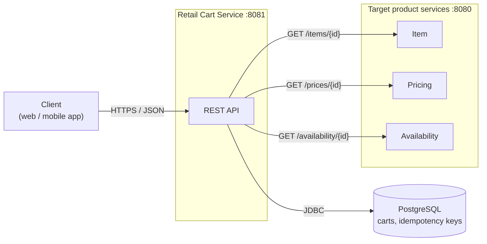
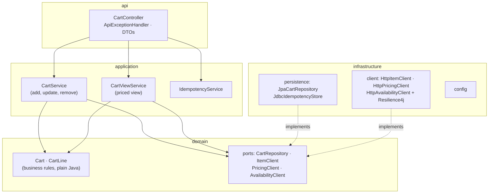
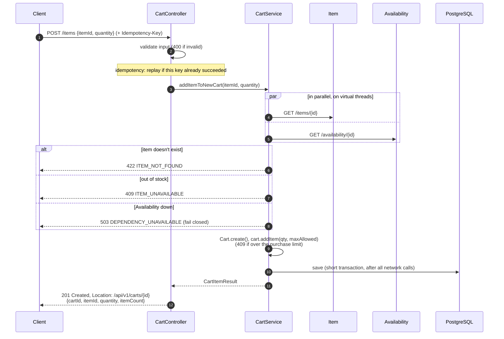
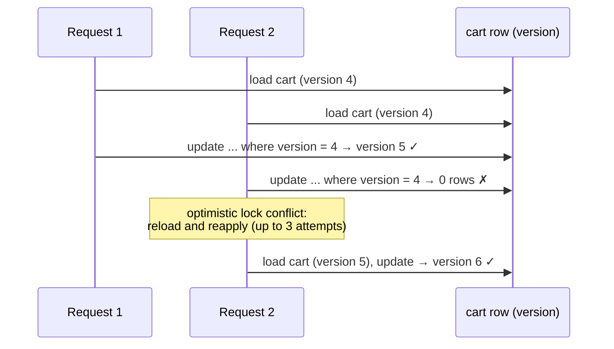
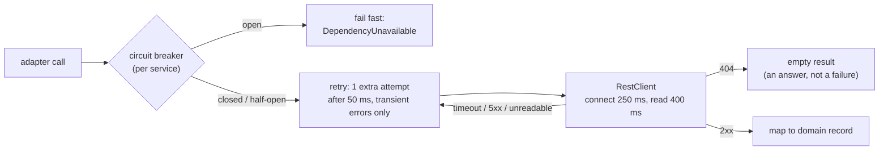
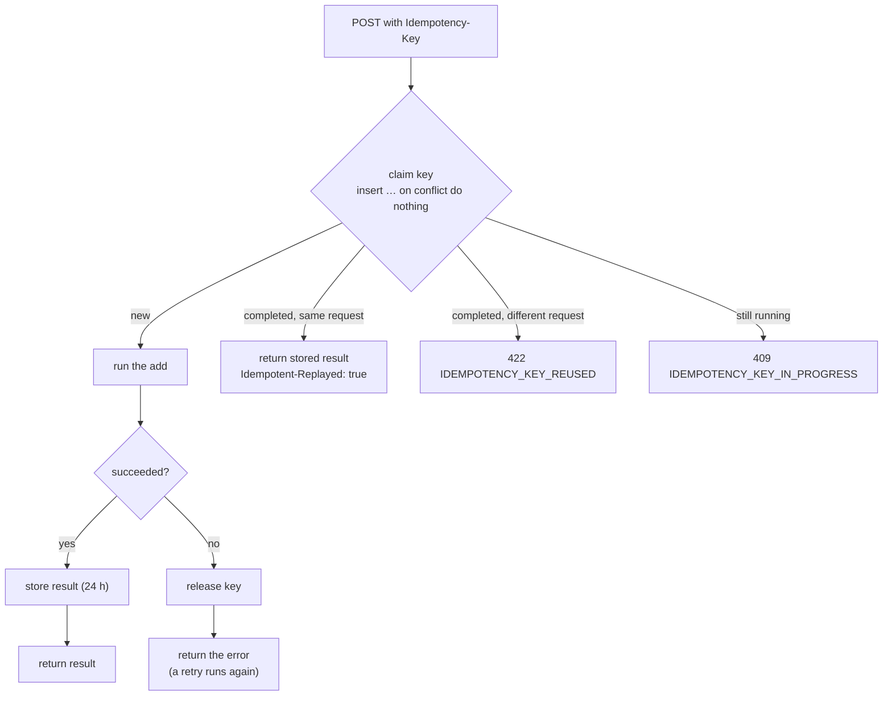
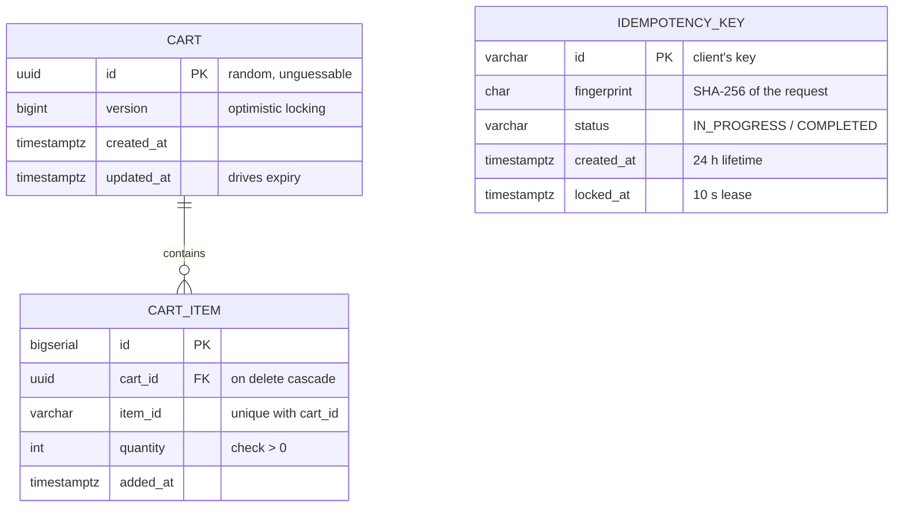

# Architecture

## 1. Context



The cart owns only **which items, how many, and when**. Names, prices and availability belong to
the product services and are fetched live, so they can never be stale in the cart.

## 2. Layers (ports and adapters)



- **Dependencies point inwards.** `domain` imports nothing from the other layers; infrastructure
  implements the domain's interfaces.
- **Rules live in `Cart`**: one line per item, quantity ≥ 1 and within the purchase limit, items
  must be in the cart to change them, expiry. They are tested with plain JUnit.
- **Services orchestrate**: decide what to ask the product services, call the `Cart`, save.
- **Adapters isolate change**: moving to another database, or to a new version of a product API,
  means replacing one adapter.

## 3. Writes: cheap, and they fail closed

### First add: `POST /api/v1/carts/items`



- Writes call only what the rule needs. **Pricing is never on the write path**, so a Pricing outage
  doesn't stop anyone adding to their cart.
- If availability can't be confirmed, the add is refused (**503 + Retry-After**) rather than
  guessed: the brief says only available items may be added.
- Adding to an existing cart is the same flow after loading the cart (404 if it's unknown or
  expired). A quantity increase re-checks Availability only; decreases and removals call nothing.

### Concurrency



Every save increments the cart's `version`, including changes that only touch line rows. No locks
are held while calling other services, and the network calls happen before the transaction opens.
After three conflicts in a row the client gets `409 CONCURRENT_MODIFICATION`.

## 4. Reads: rich, and they degrade gracefully

### `GET /api/v1/carts/{id}`

```mermaid
sequenceDiagram
    autonumber
    participant C as Client
    participant V as CartViewService
    participant DB as PostgreSQL
    participant P as Item / Pricing / Availability

    C->>V: GET /carts/{id}
    V->>DB: load cart and lines (one query)
    par for every line × 3 services, all at once
        V->>P: item details
    and
        V->>P: current price
    and
        V->>P: current availability
    end
    Note over V: each lookup: found / not found / failed<br/>(capped at 1s; a failure affects only its line)
    V->>V: per-line status, subtotal of lines that are available and priced
    V-->>C: 200 {items, subtotal, totalIncomplete, warnings, pricedAt}
```

- **Latency ≈ the slowest single call**, not the sum: every lookup for every line starts at once.
- **No stale data**: if Pricing fails, the line shows no price (`PRICE_UNAVAILABLE`), is excluded
  from the subtotal and the cart is marked `totalIncomplete: true`. An old price is never shown.

| Situation | Line status | In subtotal? | `totalIncomplete` |
|---|---|---|---|
| All good | `OK` | yes | |
| Sold out since it was added | `UNAVAILABLE` | no (can't be bought) | false |
| Availability didn't answer | `AVAILABILITY_UNKNOWN` | no | **true** |
| Pricing didn't answer | `PRICE_UNAVAILABLE` | no | **true** |
| Purchase limit dropped below the quantity | `QUANTITY_EXCEEDS_LIMIT` | yes | |
| Item details didn't answer | `DETAILS_UNAVAILABLE` (no name/image) | yes | |

Lines are flagged, never silently removed or reduced: the guest sees what changed and decides.

## 5. Calling the product services



- **Timeouts** bound every call: worst case 400 + 50 + 400 = 850 ms, inside the 1 s budget per
  lookup in the cart view.
- **Retry** is inside the circuit breaker, so a call and its retry count as one outcome. 404 and
  other 4xx responses are never retried.
- **Circuit breaker** (per service): opens when half of the last 20 calls failed (once there are at
  least 10), fails fast for 10 s, then lets 3 trial calls through. While Pricing is down, cart views
  return in milliseconds instead of waiting on timeouts.
- **Health checks cover only the database.** A product service outage must not make orchestration
  restart every cart instance: the cart is designed to keep working in degraded mode.
- Adapters clean up quirks in the product data (HTML entities in names, trailing spaces) so they
  don't leak into this API.

## 6. Retries from clients: Idempotency-Key



The primary key on the key column makes the claim race-free: of several identical requests arriving
together, exactly one runs. Known limitation: the cart write and storing the result are separate
transactions (see README, section 9).

## 7. Data model



No prices, names or availability are stored. The schema is managed by Flyway
(`src/main/resources/db/migration`); Hibernate only validates it.

## 8. Observability

- **Logs**: plain text locally, JSON (ECS) in Docker. Every line written during a request carries
  its `traceId` and `spanId`.
- **Tracing**: an incoming W3C `traceparent` is continued, and propagated on every product service
  call, including calls made from the cart view's virtual threads.
- **Metrics** (`/actuator/metrics`): HTTP server and client timings, circuit breaker state and
  calls, retry counts, JVM and database pool.
- **Health**: `/actuator/health` (plus `/liveness` and `/readiness` probes for Kubernetes) covers
  the service and its database, never the product services.

## 9. Technology

| Concern | Choice |
|---|---|
| Language / framework | Java 21, Spring Boot 4.2 (Spring Web MVC, Spring Framework 7) |
| Concurrency | Virtual threads for requests and for the parallel product lookups |
| HTTP client | Spring `RestClient` on the JDK HTTP client |
| Resilience | Resilience4j (circuit breaker, retry) |
| Persistence | PostgreSQL 17, Spring Data JPA (Hibernate 7), Flyway; plain JDBC for idempotency keys |
| API docs | springdoc-openapi (Swagger UI) |
| Tests | JUnit 5, AssertJ, Mockito, Testcontainers, WireMock; JaCoCo coverage gate |
| Build | Gradle (Kotlin DSL, version catalog), Spotless (google-java-format) |
